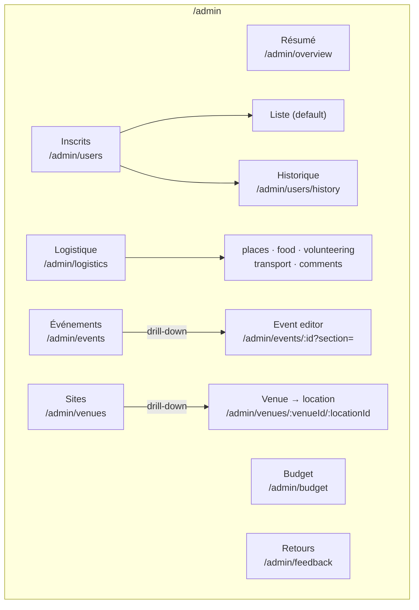

# Admin navigation: seven flat sections, one switcher per level, two page widths

Every admin feature added its own tab, sub-view or card wherever it fit. By October 2026 the admin
had 7 tabs, which filled the phone's 7-column bottom bar with no room for an 8th. Each nested level
had its own switcher (pills, a custom tablist, back buttons). « Outils » had become a catch-all,
and dense lists shared the narrow page with forms. On a 1280×800 laptop, the chrome above the
change history took 533 px ([issue #190](https://github.com/YULmix/yulmix-la-bedaine/issues/190),
[#189](https://github.com/YULmix/yulmix-la-bedaine/pull/189)). **The admin has seven flat sections,
reached from a sidebar on desktop and from a bottom bar plus « Plus » on phones. Each level has one
switcher. Every view is either dense or narrow, and the URLs are paths.**

**Status: accepted** (October 2026), decided in the design pass
[#191](https://github.com/YULmix/yulmix-la-bedaine/issues/191). It is implemented by #196 (routes),
#195 (one module per section), #208 (shell), #209 (dissolve Outils), #210 (drill-down pages) and
#211 (member pages). The shell (#208) is in: the registry is `src/lib/adminSections.ts`, the
navigation `src/components/admin/AdminNav.jsx`.

## Decisions

- **Who uses it, and where.** Organisers use the admin on a phone for everything, not only at
  the event. Every section is first-class on a phone.
- **Seven flat sections, no groups:** Résumé, Inscrits, Logistique, Budget, Événements, Sites,
  Retours. Grouping them (« Cette édition » / « Configuration ») and merging some (Budget into
  Résumé, Sites into Événements) were both rejected: they hide sections without saving a tap.
  *Since #291 Comité's navigation is Résumé, Participants, Logistique: « Participants » is a
  section for Comité only, standing in for Inscrits, which Comité doesn't open
  ([ADR 0023](./0023-edition-roles.md), [ADR 0026](./0026-comite-does-not-see-finances.md)).*
- **« Outils » is dissolved, and nothing becomes a catch-all again.** The change history is
  Inscrits' « Historique » view, because it logs registrations. The data export is an « Exporter »
  action in the Inscrits header, because it exports registrations. The feedback inbox is its own
  section, « Retours », with a count of unresolved items. A new screen goes where its data
  lives, or becomes a section; it never goes into a miscellaneous bucket.
- **Desktop (≥ `md`).** The app header stays (logo, Infos, Covoiturage, account). Below it, a
  left sidebar lists the sections, and the active section's views are nested under it. There are
  no view pills on desktop.
- **Phone (< `md`).** A bottom bar in the thumb zone shows Résumé, Inscrits, Logistique and
  Budget (Comité: Résumé, Participants, Logistique, #291), plus « Plus », a bottom sheet with Événements, Sites and Retours. A section's views
  show as the shared `ViewTabs` pills under its header. Markers (unsaved draft, unresolved
  feedback) show on the bar item, or on « Plus » when the marked section is behind it.
- **One section registry** declares each section's id, labels, icon, views, page width and
  marker. The sidebar, the bottom bar, « Plus » and `ViewTabs` all render from it.
- **Less chrome.** The « ADMIN » page title goes. Each page opens with one line: its title and
  its actions. Target: content starts at about 160 px or less on 1280×800.
- **Drill-down pages** (the event editor, venue → location) keep their parent section active.
  They open with a back link naming the parent (« ← Événements ») and a title, and their own
  sections use the shared `ViewTabs`. The party edit stays a dialog (a bottom sheet on phones).
- **Two page widths.** Each view declares its width, and the shell applies it:
  - **dense** (lists, logs, tables, dashboards: Inscrits, Logistique, Historique, Retours,
    Résumé): full width, with a list scrolling inside a box that ends on screen (« one
    scrollbar at a time », `useFitToViewport`). A dashboard's columns follow the page's width
    (container queries), not the window's, because the sidebar takes part of it;
  - **narrow** (forms, the event editor's details): a max width of about `3xl`.

  Résumé was first planned narrow, as a summary. Reviewing #208 (October 2026) showed that its
  cards side by side cramp the figures in `3xl` and leave the rest of a wide screen empty, so
  it's dense.

  *Amended by #346 (October 2026): « Bilan » is dense, but narrow before its close; since #356
  dense throughout.* See the amendment below.
- **One container.** From `md` up, the sidebar and the page share one centred container
  (`max-w-screen-2xl`), and the app header uses the same width on admin pages, so the logo
  lines up with the sidebar and the account menu with the page's right edge. The sidebar stays
  under the header while the page scrolls.
- **URLs are paths with English ids:** `/admin/<section>/<view>`, and the default view has no
  segment. One pure admin routes module parses and builds them. Every older URL (`?tab=`, `?view=`,
  `?venue=`, `?location=`, the Outils views) redirects to its path with `replace`, so the
  bookmarks and links already shared keep working.
- **Member pages keep their navigation** (header links, no bottom bar). Home, `/inscription` and
  Infos are narrow, and `/carpool` is dense if its board needs the width.

## Consequences

- An 8th section adds one row under « Plus » and one entry in the sidebar. The phone bar stays
  at four plus « Plus ». Changing which sections are in the bar is a decision, not a side effect
  of order.
- Sections become independent modules (#195). The shell mounts only the current section, so
  drafts live in stores rather than in a component that stays mounted.
- Reviewers check a new screen against the rules in the
  [frontend guide](../05-frontend-guide.md#adding-an-admin-section-or-view): where it lives, which
  width it has, and which switcher reaches it.
- `.ulpi/design/redesign.md` §2 describes the information architecture this replaces, and
  points here.

## Amendment (#346): « Bilan » is dense, but narrow before the close

« Bilan » was narrow: free texts to read. Its approved redesign (#346, the organiser, 2026-10-26)
shows the answers after the close as one tinted card per category in a grid of up to three columns,
because one narrow column of eight cards wasted most of a wide screen and made a long scroll. So:

- the registry declares Bilan **dense**;
- **before the close** the section narrows itself to `max-w-3xl` (it holds only the counts and the
  close date, a narrow page's content);
- **after the close** the answers take the page's full width: one column, two from a `3xl`
  container, three from `6xl` (container queries, like a dashboard here), read left to right then
  down, the cards of a row stretched to the same height. The counts above them stay `max-w-3xl`.

The section is the one place where the width depends on the data. It is not a third width: the
shell still applies one of the two, and the section narrows its own content within it.

*Since #356 (October 2026)* the comments are read live, so the section is the same before and after
the close: always full width, the comments' grid as above, the counts' card full width too, its
per-category tiles four across from a `3xl` container. The narrow « before the
close » state is gone, and the width no longer depends on the data.

