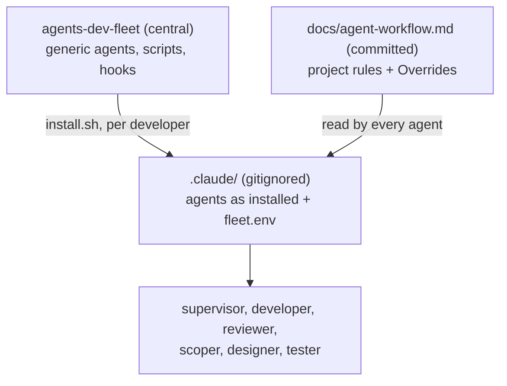

# The agent fleet comes from one central toolkit; La Bédaine keeps only its overrides

Since September 2026 the organiser has run the issue backlog with a fleet of Claude Code agents
(a supervisor that dispatches, developers that implement and verify, a reviewer for risky changes, a
scoper that files issues). Those agent definitions were written for this repo and lived in the
gitignored `.claude/agents/`, with every project fact (commands, the local database lock, review
triggers, issue conventions) hard-coded in them. Meanwhile the same fleet was generalised into a
private, personal toolkit, **agents-dev-fleet**, which carries no project knowledge and reads one
project file instead. The two copies drifted: improvements made centrally (an automatic supervisor
handoff, a CI guard, a quota gate based on how fast usage is climbing, `gh stack`) never reached
La Bédaine, and La Bédaine's own rules would have been lost by a reinstall.

**Decision: La Bédaine uses the central fleet as installed, per developer under the gitignored
`.claude/`, and keeps everything specific to this project in one shared, committed file,
[`docs/agent-workflow.md`](../agent-workflow.md). Where this project deliberately works differently
from the generic agents, the difference is an entry in that file's "Overrides" section (which the
agents are told wins over their own definitions) or a setting in `.claude/fleet.env`; the agent
files are never edited here.**

**Status: accepted** (October 2026), decided by the organiser.

## Decisions

- **Shared vs personal.** The fleet stays personal tooling (`.claude/` remains gitignored, as
  [Development setup → Agent tooling](../07-development-setup.md#agent-tooling-in-this-repo) says);
  the project's rules for agents are shared, so any contributor's agent reads the same ones.
- **Overrides kept** (where La Bédaine differs from the generic fleet on purpose):
  - **Issue conventions.** Priority and Effort are GitHub's native issue fields, not labels; only
    `ready-for-agent` issues are dispatched (`needs-info`, `needs-triage`, `ready-for-human` never);
    an issue and its PR are assigned to the organiser when claimed; the scoper's Agent Brief format
    and wayfinder maps.
  - **The Preview database flow.** Preview failures are fixed first; a migration PR is applied to
    Preview once its CI is green so the organiser can try the Vercel preview; one migration branch on
    Preview at a time.
  - **One issue at a time**, a second only when truly independent (`FLEET_MAX_LANES=2`): every
    developer shares one local Supabase behind a lock, so more lanes only queue, and parallel
    branches here have collided on the e2e dependency chain, redefined SQL functions and migration
    timestamps.
  - **Only the organiser merges**, since a merge applies migrations to production
    ([ADR 0014](./0014-ci-applies-migrations-on-merge.md)).
- **Central behaviour adopted** in place of the old local one: the fleet does visual QA (the
  organiser is not asked to check screens); the quota gate based on how fast usage is climbing; the
  automatic supervisor handoff at 150k tokens of context, with a retro, a verbatim log of the
  organiser's decisions and per-session reports; the CI guard; `gh stack` for stacked branches.
- **Decisions live in the repo.** A decision made while working (design, product, process) goes in
  an ADR or the relevant doc, in the PR it belongs to; a memory tool holds at most tool and
  environment gotchas. The old fleet saved the organiser's decisions to a personal memory store,
  where nobody else could read them and keyword search found them unreliably.

## Consequences

- Upgrading the fleet is `install.sh --force` from the central toolkit; nothing project-specific is
  overwritten, because nothing project-specific lives in the installed files.
- A contributor without the fleet loses nothing: `docs/agent-workflow.md` is ordinary documentation
  of how work is verified, reviewed and filed here.
- `docs/agent-workflow.md`'s section headings are a contract with the agents; renaming one breaks
  them.
- Process lessons about the fleet in general go to the central toolkit; lessons about this project
  go in `docs/agent-workflow.md`.
