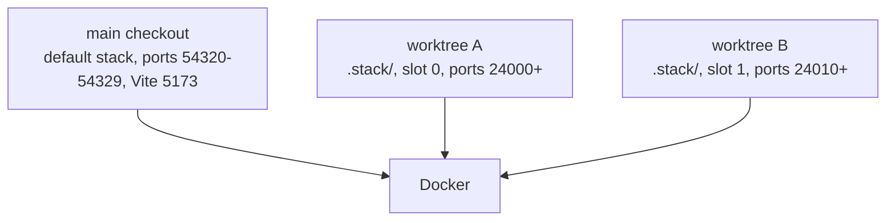

# One local Supabase stack per git worktree; the shared stack and its lock are gone

Until October 2026 every worktree and agent shared **one** local Supabase stack and Vite port 5173,
serialised by a `flock` ([ADR 0027](./0027-central-agent-fleet-with-project-overrides.md)). Each
database check began with a `supabase db reset`, so nothing seen in an earlier block could be
assumed in the next; two developers that both ran database checks queued behind each other (#308
waited behind #310), so a second lane could only take work that needed no database.

**Decision: a linked git worktree runs its own local Supabase stack (`npm run stack:up`), with ports
derived from a slot taken from its path and its own database, so worktrees and agents never share a
database, a port or a reset. The main checkout keeps the default `supabase start` stack and
needs nothing. The lock is removed.**

**Status: accepted** (October 2026), decided by the organiser on #313, implemented by #312.

## Decisions

- **One stack per linked worktree**, started with `npm run stack:up` after `npm ci`. It runs from a
  generated, gitignored workdir `.stack/` (a copy of `supabase/config.toml` with a unique project id
  and shifted ports, linked to `supabase/migrations`, `functions`, `seed.sql` and `seeds`) passed to
  the CLI with `--workdir`; `supabase/config.toml` itself is untouched.
- **Ports from a slot.** A block of 10 ports from 24000, chosen from the worktree's path and checked
  free (a taken slot moves to the next). Playwright and Vite use the stack's own port.
- **Trimmed services.** Studio, Logflare and Vector are not started; Edge Functions are served so
  « Voir comme » works.
- **The main checkout is the organiser's.** Agents never touch it or its stack; a bare `supabase`
  command in a worktree still targets that default stack, so agents use `npm run stack:cli -- …`.
- **Explicit cleanup.** `npm run stack:down` removes a stack; `npm run stack:prune` removes the
  stacks of worktrees whose directory no longer exists. The supervisor prunes after each merge.
- **Capacity follows the file rules, not the database.** The shared database is no longer a reason
  to run one issue at a time: two lanes (`FLEET_MAX_LANES=2`) when the items pass the
  "Parallelism" conditions in `docs/agent-workflow.md` (disjoint files and SQL objects).

## Consequences

- A trimmed stack costs about 1.4 GB of RAM (roughly 800 MB idle, more under an e2e run), per
  running worktree on top of the organiser's own stack; stop stacks you don't need.
- Agents verify on a fresh worktree with `stack:up`, a reset of their own stack, and the tests, with
  no waiting and no assumption about anyone else's data.
- Parallel branches can still collide on the e2e dependency chain, redefined SQL functions and
  migration timestamps; the "Parallelism" rules, not a lock, guard against that.
- Orphan stacks from deleted worktrees hold containers and volumes until pruned.
