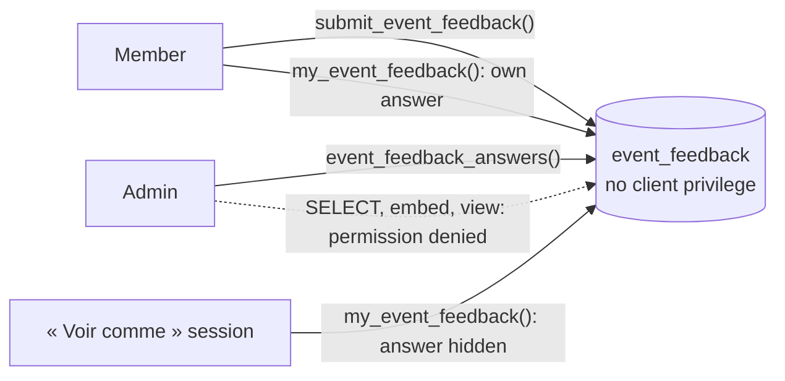

# Anonymous post-mortem answers: the table is closed to every client

After an event, the organisers collect a post-mortem, the « bilan »: one free text per category
from each registration, anonymous if the respondent chooses, readable by account admins only
([issue #315](https://github.com/YULmix/yulmix-la-bedaine/issues/315), epic #309). An admin can read
every registration, profile and change history, so "anonymous" can't be a matter of hiding a
column on screen: the author must be unreachable from anything the admin can query. **The answers
live in `event_feedback`, on which no client role (admins, `service_role` included) holds any
privilege. Three `SECURITY DEFINER` functions are the only way in, and the admin's read gives an
anonymous answer's texts and nothing else.**

**Status: accepted** (October 2026), implemented by #315: migration
`20261026043829_event_feedback.sql`. The rules (one answer per registration, the window, who is
eligible, admins only) were decided by the organiser in triage on #315.

## Decisions

- **No table privilege, no policy.** `event_feedback` has RLS on and no policy, and its grants are
  revoked from `anon`, `authenticated` and `service_role`. Nothing embeds it from `user_parties`,
  and no view reads it. A table-level `SELECT` for admins, even of selected columns or through a
  view, would hand them `party_id`, and through it `user_parties.user_id` and the profile.
- **The admin's read leaves out everything that leads back to the author.** For an anonymous
  answer, `event_feedback_answers()` returns the texts and `is_anonymous` only: no user, party, row
  id, `created_at` nor `updated_at` (a time could be matched against other activity). Anonymous
  answers come after the named ones, ordered by their random id, so their position says nothing
  either. A named answer carries the author's id, party, name and email, and its times.
- **« Voir comme » hides the member's answer.** [ADR 0025](./0025-voir-comme-read-only-impersonation.md)
  lets an admin open the app in a member's real session, which would show the member's own
  answer and whether it is anonymous. In such a session (`impersonated_by` in the JWT)
  `my_event_feedback()` returns no answer and `answer_hidden: true`, whether or not there is one,
  so the session says nothing about who answered. This is the one place where « Voir comme »
  deliberately differs from what the member sees. Writes are refused there anyway by the read-only
  trigger.
- **Accepted limits.** Anonymity is per answer and the respondent can change it: making a named
  answer anonymous later doesn't erase what an admin already read. With very few answers, the
  texts themselves (or the count of named versus anonymous ones) may give someone away; the
  database can't prevent that. The database owner and direct connections (migrations, backups)
  still see everything.

## Options considered

- **Functions only, table closed (chosen).** One place decides what an admin sees; adding a
  column can't leak it by accident, since every output names its fields.
- **Admin `SELECT` policy plus a view that blanks the author.** The base table would stay readable
  by admins, `party_id` included, and the view would need `security_invoker` off to hide it.
  Rejected.
- **Store no `party_id` for anonymous answers** (a hash or a separate link table). It would take
  "one answer per registration, editable" away, or move the link somewhere else just as
  reachable. Rejected.

## Consequences

- Any new reader of `event_feedback` (an export, an Edge Function) is a new `SECURITY DEFINER`
  function that names its output and applies the same rule for anonymous answers. The RLS suite
  (« post-mortem feedback ») lists every function that reads the table and fails when one is added
  without updating it.
- Answers are not deleted (ADR 0024): nothing deletes one; it goes with its party only if an admin
  deletes the party.
