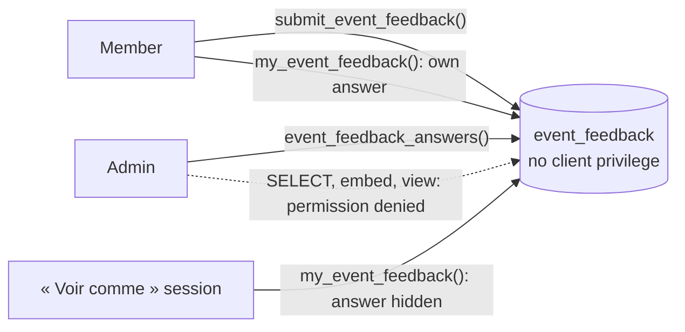

# Anonymous post-mortem answers: the table is closed to every client

After an event, the organisers collect a post-mortem, the « bilan »: one free text per category
from each registration, anonymous if the respondent chooses, readable by account admins only
([issue #315](https://github.com/YULmix/yulmix-la-bedaine/issues/315), epic #309). An admin can read
every registration, profile and change history, so "anonymous" can't be a matter of hiding a
column on screen: the author must be unreachable from anything the admin can query. **The answers
live in `event_feedback`, on which no client role (admins, `service_role` included) holds any
privilege. Three `SECURITY DEFINER` functions are the only way in, and the admin's read gives an
anonymous answer's texts and nothing else.**

**Status: accepted** (October 2026), implemented by #315: migration
`20261026043829_event_feedback.sql`. The rules (one answer per registration, the window, who is
eligible, admins only) were decided by the organiser in triage on #315; the answer's fixed author
and event, and keeping it when its party is deleted, by the organiser after #315's review.

## Decisions

- **No table privilege, no policy.** `event_feedback` has RLS on and no policy, and its grants are
  revoked from `anon`, `authenticated` and `service_role`. Nothing embeds it from `user_parties`,
  and no view reads it. A table-level `SELECT` for admins, even of selected columns or through a
  view, would hand them `author_id` (or `party_id`, and through it the profile).
- **An answer belongs to its author and its event, not to the party.** Admins can write any
  `user_parties` row: change its owner or event, or delete it. If the answer followed the party,
  an admin could make a party theirs and read the anonymous answer in `my_event_feedback()` (or
  overwrite it), or find its author by moving parties to another event, or deleting them, and
  watching which move takes the answer out of the event's list. So `event_feedback` stores
  `event_id` and `author_id` (`auth.uid()`) at the first write, keeps them (a trigger), and every
  function matches on them: the member reads and edits the answer they wrote, the admin's list is
  the answers stored for the event. `party_id` only records the registration it came from. One
  answer per member per event (`UNIQUE (event_id, author_id)`): in the normal case, one per
  registration; a party whose owner an admin changes may carry a second one, the new owner's.
- **Deleting a party keeps its answer** on its event (`party_id` `ON DELETE SET NULL`), anonymous
  or not as written: a cascade would make the delete an oracle too, and remove free text against
  [ADR 0024](./0024-no-hard-deletes.md). Refusing the delete (`ON DELETE RESTRICT`) was not chosen:
  the refusal itself would say which party has an answer. Account deletion (`delete_my_account()`,
  a soft delete) leaves answers as written too, like the rest of the member's history; no output
  ever gives an anonymous answer's `author_id`, so it never becomes attributable.
- **The admin's read leaves out everything that leads back to the author.** For an anonymous
  answer, `event_feedback_answers()` returns the texts and `is_anonymous` only: no user, party, row
  id, `created_at` nor `updated_at` (a time could be matched against other activity). Anonymous
  answers come after the named ones, ordered by their random id, so their position says nothing
  either. A named answer carries the author's id, party, name and email, and its times.
- **« Voir comme » hides the member's answer.** [ADR 0025](./0025-voir-comme-read-only-impersonation.md)
  lets an admin open the app in a member's real session, which would show the member's own
  answer and whether it is anonymous. In such a session (`impersonated_by` in the JWT)
  `my_event_feedback()` returns no answer and `answer_hidden: true`, whether or not there is one,
  so the session says nothing about who answered. This is the one place where « Voir comme »
  deliberately differs from what the member sees. Writes are refused there anyway by the read-only
  trigger, which `submit_event_feedback()` applies before any other check.
- **Accepted limits.** The threat this design is built against is an account admin: they read
  every registration, profile and change history, and write `user_parties` (owner, event,
  deletion); none of those writes reaches an answer, and no read gives an anonymous answer's
  author. Anonymity is per answer and the respondent can change it: making a named
  answer anonymous later doesn't erase what an admin already read. With very few answers, the
  texts themselves (or the count of named versus anonymous ones) may give someone away; so may
  polling `event_feedback_answers()`: an anonymous answer that appears or changes between two
  polls can be matched against other activity at that time (a sign-in, a registration edit),
  although the result carries no time. The database can't prevent either. The database owner and direct connections (migrations, backups)
  still see everything.

## Options considered

- **Functions only, table closed (chosen).** One place decides what an admin sees; adding a
  column can't leak it by accident, since every output names its fields.
- **Admin `SELECT` policy plus a view that blanks the author.** The base table would stay readable
  by admins, `party_id` included, and the view would need `security_invoker` off to hide it.
  Rejected.
- **Store no author for anonymous answers** (a hash or a separate link table). It would take
  "one answer per member, editable" away, or move the link somewhere else just as reachable.
  Rejected.
- **Let the answer follow its party, and refuse an owner or event change on a party that has one**
  (a trigger on `user_parties`). The refusal would say which parties have an answer, and those
  missing from the named list are the anonymous authors; it also can't cover a delete without
  the same oracle. Rejected for a fixed author and event.

## Consequences

- Any new reader of `event_feedback` (an export, an Edge Function) is a new `SECURITY DEFINER`
  function that names its output and applies the same rule for anonymous answers. The RLS suite
  (« post-mortem feedback ») lists every function that reads the table and fails when one is added
  without updating it.
- Answers are not deleted (ADR 0024): nothing deletes one, a deleted party leaves it, and only a
  hard-deleted event (not something the app does) takes its answers with it.
- An admin who makes a party theirs answers as themselves: their answer is named or anonymous like
  anyone's, and the previous owner keeps theirs (readable, no longer editable once they own no
  registration on the event).
